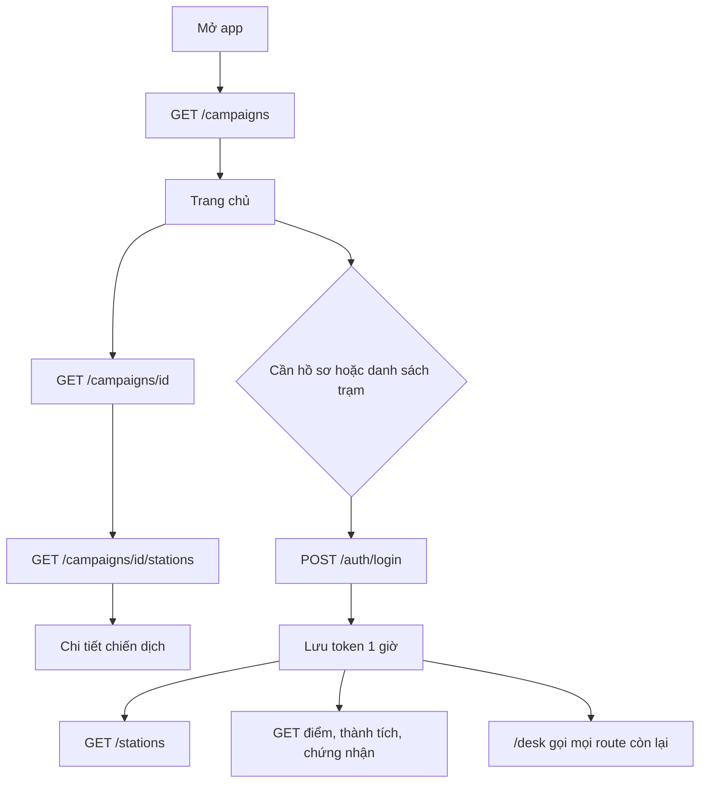
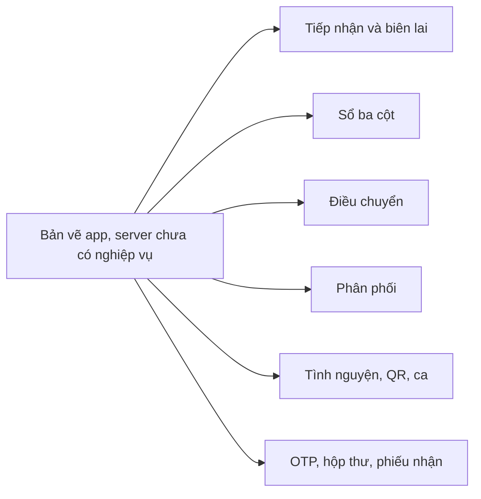

# Luồng dữ liệu Pass Đồ

Server trong `PassThingsCharity-server` giữ luồng nghiệp vụ. App ở `PassThingsCharity-mobile` gọi API tại `http://localhost:8080`. Chi tiết cho AI đọc nằm trong `AGENTS.md`.

Đăng ký là `POST /auth/register` rồi login. Sửa hồ sơ, đổi mật khẩu, xóa tài khoản nằm ở `/account`.

Sơ đồ dưới là các màn app tự vẽ. Server chưa có các nghiệp vụ đó, nên không sửa API cho khớp màn.
