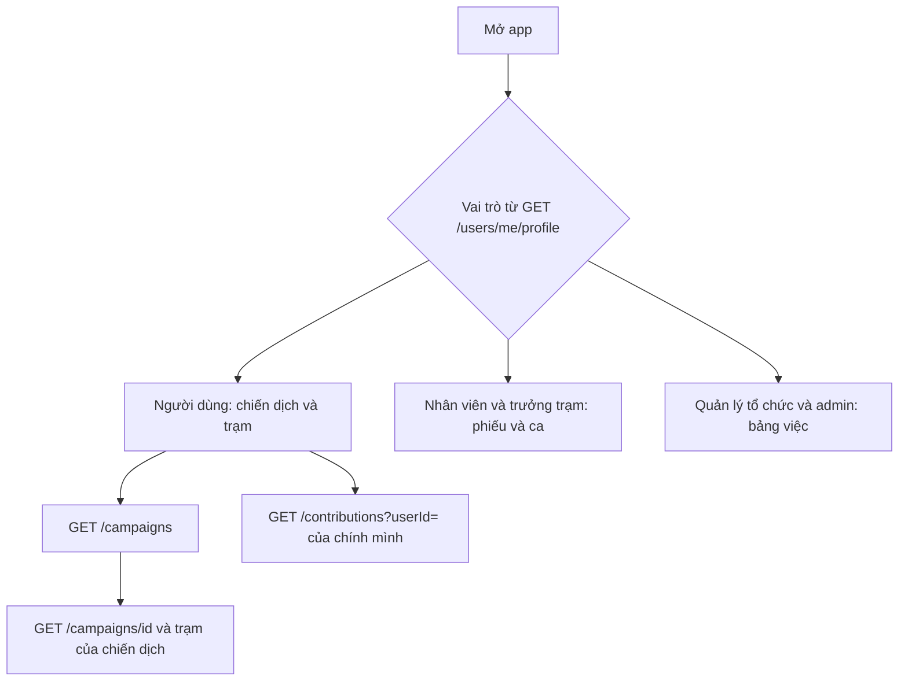
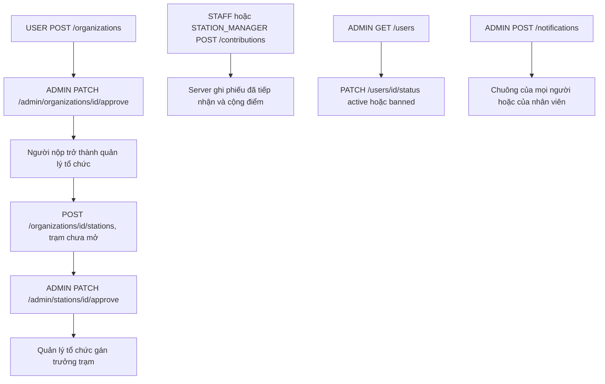

# Luồng dữ liệu Pass Đồ

Server trong `PassThingsCharity-server` giữ luồng nghiệp vụ. App ở `PassThingsCharity-mobile` gọi API đó. `app.json` trỏ host công khai `https://passthingscharity-api.onrender.com`. Đặt `EXPO_PUBLIC_API_URL` khi cần máy chủ khác. Lời gọi tới host công khai được ký bằng `EXPO_PUBLIC_APP_SIGNING_SECRET` lúc build. Chi tiết cho AI đọc nằm trong `AGENTS.md`.

Thư mục `PassThingsCharity-mobile/ios` không nằm trên nhánh này. Dự án Xcode để cài máy nằm trên nhánh `ios`.

Người dùng và khách xem Khám phá, Tặng đồ, Trạm gom, Hồ sơ. Nhân viên, trưởng trạm, quản lý tổ chức và admin mở app vào việc của vai đó. Quản lý tổ chức có thêm chế độ Đóng góp để vẫn mang đồ tới trạm như người dùng.

Đăng ký là `POST /auth/register` rồi login. Sửa hồ sơ, đổi mật khẩu, xóa tài khoản nằm ở `/account`.

Chiến dịch `ACTIVE` hiện là đang nhận đồ. `PUBLISHED` trước ngày bắt đầu là sắp mở. Admin không lập phiếu tiếp nhận và không tạo tổ chức hay trạm trên app. Người dùng nộp đơn tổ chức. Quản lý tổ chức tạo trạm. Admin duyệt.
