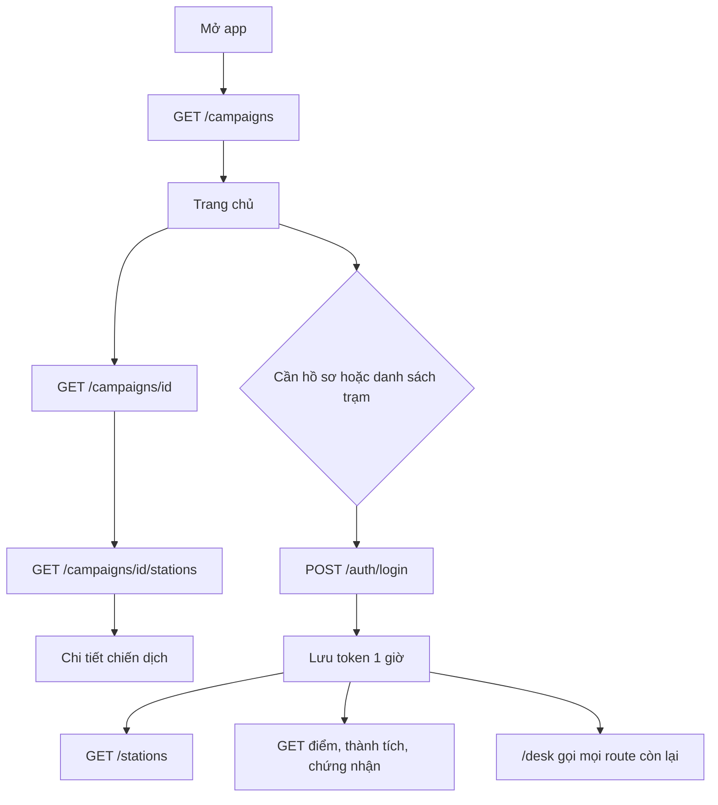
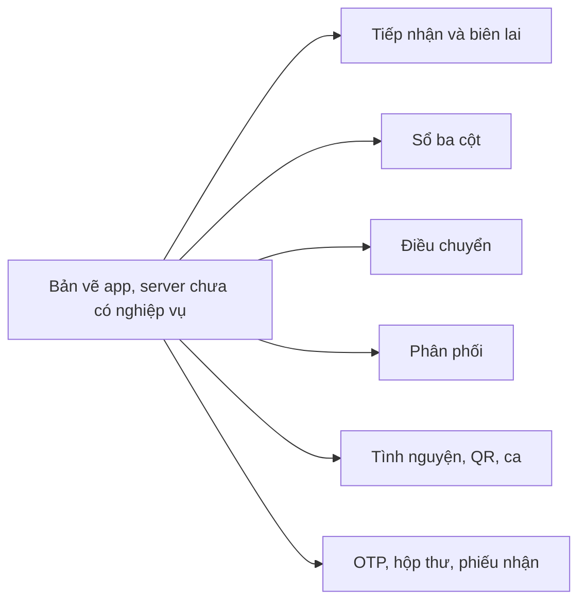

# Luồng dữ liệu Pass Đồ

## Làm phần Android

Repo: https://github.com/tnhan23/PassThingsCharity

`feature/fe` giữ màn hình Expo dùng chung và máy chủ mà các màn hình đang gọi. Nhánh `android` nằm ngay phía trên, chỉ thêm project Android. Nhánh `ios` cũng nằm ngay phía trên `feature/fe`, chỉ thêm project iPhone. Nhánh `deploy` là máy chủ đang chạy trên Render. Không đẩy code vào `deploy`.

Lấy mã:

```bash
git clone https://github.com/tnhan23/PassThingsCharity.git
cd PassThingsCharity
git checkout android
cd PassThingsCharity-mobile
npm ci
```

Nhánh `android` đã có `src` dùng chung và thư mục `PassThingsCharity-mobile/android`.

Commit theo chỗ file bị sửa:

- Sửa `src/` hoặc phần `app.json` cả hai máy đều dùng: tách nhánh từ `feature/fe`, mở merge request vào `feature/fe`. Sau khi nhận, merge `feature/fe` vào `android` và `ios`.
- Sửa `PassThingsCharity-mobile/android/`: tách nhánh từ `android`, mở merge request vào `android`.
- Một việc đụng cả hai: hai commit, hai merge request. Không đưa thư mục `android/` vào merge request của `feature/fe`.

Build cần Android Studio, JDK, và một máy hoặc máy ảo Android:

```bash
export EXPO_PUBLIC_API_URL="https://passthingscharity-api.onrender.com"
export EXPO_PUBLIC_APP_SIGNING_SECRET="lấy riêng, không ghi vào git"
npx expo run:android
```

Hai biến phải có lúc đóng gói JavaScript. Không commit secret. Không đặt `EXPO_PUBLIC_APP_ATTEST`.

App tự ký mỗi request gửi host Render bằng header `X-App-Time` và `X-App-Sign`. Máy chủ không phân biệt Android hay iPhone. Giờ máy phải đúng trong khoảng hai phút. Request không ký bị cắt và app hiện như không kết nối được. Lần mở đầu có thể chờ gần một phút vì gói miễn phí đang ngủ.

Định vị ghi trong `app.json` và đưa vào merge request của `feature/fe`:

```json
[
  "expo-maps",
  {
    "requestLocationPermission": true,
    "locationPermission": "Pass Things Charity dùng vị trí của bạn khi đang mở app để hiện trạm gần và khoảng cách tới điểm nhận đồ."
  }
],
"expo-location"
```

Nếu manifest chưa có `ACCESS_FINE_LOCATION` và `ACCESS_COARSE_LOCATION`, trên nhánh `android` chạy `npx expo prebuild --platform android`, rồi commit thư mục `android/`.

Bản đồ trong `src/screens/more.tsx` đang chỉ vẽ Apple Maps. Trên Android cần vẽ `GoogleMaps.View` khi `Platform.OS` là `android`. Sửa file này trên nhánh tách từ `feature/fe`. Các prop `cameraPosition`, `markers`, `properties`, `uiSettings`, `onCameraMove`, `onMarkerClick`, `setCameraPosition` dùng cùng dạng với bản iPhone.

Key Google Maps để trong `app.json`. Package là `vn.passdo.app`:

```json
"android": {
  "package": "vn.passdo.app",
  "config": {
    "googleMaps": {
      "apiKey": "key của Maps SDK for Android"
    }
  }
}
```

Trên Google Cloud, bật Maps SDK for Android và giới hạn key theo package `vn.passdo.app` cùng SHA-1 của keystore. Bản debug dùng `android/app/debug.keystore`, mật khẩu và alias đều là `androiddebugkey`:

```bash
keytool -list -v -keystore android/app/debug.keystore -alias androiddebugkey
```

Nếu project Android lệch SDK vì thư mục `android` được tạo trước Expo SDK 58, chạy `npx expo prebuild --platform android` và commit phần native vào nhánh `android`.

Kho theo trạm, công thức điểm mới, trạm gần và giấy chứng nhận PDF đang ở nhánh `develop`, chưa có trên `feature/fe` và chưa có màn hình. Chưa được giao thì không tự merge `develop`. Khi được giao vẽ các màn đó, `feature/fe` phải nhận code `develop` trước.

## Sơ đồ cũ

Server trong `PassThingsCharity-server` giữ luồng nghiệp vụ. App ở `PassThingsCharity-mobile` gọi API tại `http://localhost:8080`. Chi tiết cho AI đọc nằm trong `AGENTS.md`. Sơ đồ dưới mô tả luồng cũ, không phải danh sách việc của nhánh Android.



Đăng ký là `POST /auth/register` rồi login. Sửa hồ sơ, đổi mật khẩu, xóa tài khoản nằm ở `/account`.



Sơ đồ dưới là các màn app tự vẽ. Server chưa có các nghiệp vụ đó, nên không sửa API cho khớp màn.
